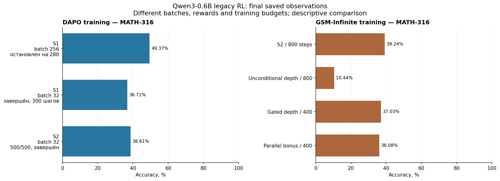

# Qwen3-0.6B и Qwen3-4B: эксперименты, конфигурации и графики

Архив результатов, собранный 12 октября 2026 года из локальных `exps/`,
`work/experiments/` и того же проекта на общей NFS через `ssh ${REMOTE_SSH_ALIAS}`.
Основной сбор: 20:38–20:52 МСК; дополнительные исходники формул и конфигурации
benchmark сохранены позднее и имеют собственное время в `manifest.json`.
Это фиксированные наблюдения, а не страница текущего состояния задач.

## Как читать архив

- [Все 84 найденных каталога](CATALOG.md): обучение, оценки, абляции,
  подготовка данных, технические пробы и неуспешные попытки. Один каталог может
  содержать несколько экспериментов. Число каталогов не равно числу завершённых
  обучений.
- [Таблица конфигураций запусков](TRAINING_CONFIGURATIONS.md): модель/checkpoint,
  данные, GPU, batch, n, LR, шаги, precision и loss/advantage; каждая строка ведёт
  к полному YAML/JSON. В исходниках сохранены также optimizer, seed, sampling,
  KL, microbatch, scheduler, overrides и hashes данных.
- [Графики](FIGURES.md): 62 исторических файла графиков и 68 новых групп
  графиков, включая четыре сводных сравнения и кривые сохранённых training streams.
- [Индекс числовых полей](metrics-index.csv), [provenance](manifest.json),
  [контрольные суммы](SHA256SUMS).

`artifacts/` сохраняет пути внутри исходного проекта. `history/` содержит
отличающиеся наблюдения того же файла. Для каждого артефакта указаны источник,
время сбора, исходный SHA-256, SHA-256 сохранённого файла и преобразование, если
оно применялось. Из legacy logs извлечены только числовые метрики. Веса,
optimizer states, исходные датасеты и полные generated traces сюда не входят;
их идентичность фиксируется manifests и hashes.

Внутренние абсолютные пути заменены [переносимыми placeholders](PATHS.md),
а идентификаторы вычислительных allocation — стабильными обезличенными aliases.
Исходные SHA-256 сохранены для provenance; SHA-256 опубликованных файлов
пересчитаны после замены. Числа метрик и параметры обучения/оценки сохранены.

Accuracy использует все оценённые задачи. `correct + parallel` требует
правильного ответа и соответствующего сохранённого verdict о формате/выполненном
fork. Это не проверка смысловой полезности ветвей. Стоимость на всех задачах и
стоимость только среди format-valid задач имеют разные знаменатели.
MATH-316, MATH-500, mixed128 и selection val32 показаны отдельно.

## 0.6B: первоначальные SFT и оценки, 5–6 октября

[Ablation queue](runs/exps--ablation-queue-20261005.md),
[исправленные Seen/Unseen](runs/exps--fixes-20261005.md),
[tag-loss ×4](runs/exps--tag-loss-x4-20261005.md) и
[Unseen по эпохам](runs/exps--qwen3-06b-unseen-20261005.md) сохраняют отдельные
model/epoch записи. Seen использовал обычную последовательную attention;
Unseen — изоляцию sibling Path и повторяющиеся позиции. В fixed-mb4 варианте
сохранены max length 3072, microbatch 4/GPU и отключённый gradient checkpointing.
Разрешённый бюджет кампании — 8 GPU. Полные фактические Hydra-конфигурации
каждого обучения и evaluation находятся в карточках и таблице конфигураций.

Основной ранний evaluation: 1916 ответов — AIME24 30×16, AIME25 30×16,
AMC23 40×16 и MATH-316 316×1; temperature 1, response limit 3000.
Mean accuracy, observed pass и bootstrap estimates сохранены раздельно.
Async/sync варианты не объединены. Отдельная
[MATH mean@16 оценка](runs/exps--math-mean16-20261006.md) имеет другой n.

Сохранены также обычные Instruct instant/reasoning оценки, prompt/padding/loss
диагностика и остановленные 16k/32k попытки. Их planned config не заменяет
фактически завершённые ответы; coverage и terminal status доступны в карточках.
Ранние [4B Base](runs/exps--qwen3-4b-base-20261005.md) и
[публичные 4B веса](runs/exps--qwen3-4b-public-20261005.md) остаются отдельными
историческими контролями со своими model-source и benchmark identities.

## 0.6B: DAPO S1/S2 и GSM reward-абляции, 6–8 октября

S1/S2 стартовали из исправленного Unseen-SFT 0.6B, а не из предыдущего RL.
DAPO train содержит 17 917 вопросов. Legacy validation — 1916 ответов,
включая MATH-316. S1 batch256 имел PPO minibatch128; batch32 варианты —
minibatch16, microbatch2/GPU, n8, token-mean loss, LR `1e-6`, 8 A100.
Таким образом, batch32 означает 32 prompt ×8 responses =256 ответов/step,
а batch256 —2048 ответов/step. Шаги разных batch не равны по объёму работы.

S1 использовал accuracy reward и clip-high0.2. S2 сохранил авторскую
периодическую награду: правильный ответ +1, неправильный −1; правильный
валидный parallel-ответ получает +1.2 на шагах9/10 каждого цикла.
S2 batch32 использовал clip-high0.28, NO_SHARD replication, skip-zero-advantage
microbatches и exact decode graphs. S1 batch32 использовал FULL_SHARD и
отключённый skip-zero. S2 до500 продолжил собственный complete-state step30;
это470 дополнительных updates. Дальнейшие checkpoints сохраняли только HF.
[S1 recipe](artifacts/exps/rl-unseen-s1-bs32-20261007/manifest.json),
[S2 continuation](artifacts/exps/rl-unseen-s2-bs32-500-20261007/manifest.json).

| DAPO run | Последний validation step | MATH-316 |
|---|---:|---:|
| S1 batch256, остановлен | 280 | 156/316 =49.37% |
| S1 batch32, завершён | 300 | 116/316 =36.71% |
| S2 batch32, завершён | 500 | 122/316 =38.61% |

GSM-Infinite train: 4547 строк из `gsm_infinite_medium_0`, ops2–6;
held-out GSM256 +MATH316. Каждый reward-arm стартовал независимо из того же
Unseen-SFT. Общий recipe:8 GPU, prompt batch32, n8, PPO mini16, micro2/GPU,
LR`1e-6`, clip-high0.28, validation каждые50 шагов. В двух первых arms800steps,
в split-advantage паре400steps. Здесь `c` — binary correctness, `D` — critical
sampled depth, `T` — sampled tokens, `v` — сохранённый valid-parallel verdict.

| Arm | Награда | Steps | GSM256 | MATH316 |
|---|---|---:|---:|---:|
| S2 | Авторская S2 | 800 | 235/256 =91.80% | 124/316 =39.24% |
| Unconditional depth | `c − 0.0001 D` | 800 | 215/256 =83.98% | 33/316 =10.44% |
| Gated depth, split A | `c − 0.0001 c D` | 400 | 224/256 =87.50% | 117/316 =37.03% |
| Parallel gain, split A | `c + 0.2 c v (1 − D/T)` | 400 | 219/256 =85.55% | 114/316 =36.08% |

Источники: [финальный S2/depth report](artifacts/exps/gsm-unseen-two-rewards-20261008/report.json),
[complete split snapshot](artifacts/exps/gsm-unseen-split-rewards-400-20261008/completed-snapshot-20261008.json),
[две полные конфигурации reward-кампаний](runs/exps--gsm-unseen-two-rewards-20261008.md),
[split reward recipe](runs/exps--gsm-unseen-split-rewards-400-20261008.md).



Legacy vLLM generation и actor recomputation имели различающиеся
attention/position semantics; вручную вставленные control tokens могли входить
в PPO loss. Исторические результаты сохранены с этим ограничением.
Полные финальные GSM-кривые и компоненты reward/advantage находятся в
[experiment history](runs/exps--experiment-history-20261008.md).

Dataset screening использовал256 prompts ×8 responses по каждому набору;
audited accuracy и mixed groups1–7/8 — разные метрики. DAPO4.44%/24.22%,
GSM-Infinite18.55%/71.88%, Orca31.84%/58.59%, CN K12 21.04%/48.05%.
[Screening и grader disagreements](runs/exps--rl-dataset-screen-20261007.md).

## 0.6B: native 32k и SFT на трёх наборах

Native baseline — `Qwen/Qwen3-0.6B`, revision
`c1899de289a04d12100db370d81485cdf75e47ca`, BF16 vLLM0.8.5.post1,
Transformers4.53.2, native chat template, seed42. Полный MATH-500, n1,
32768 output tokens, model context40960. Instant: temperature0.7,
top-p0.8, top-k20, presence penalty1.5. Reasoning: temperature0.6,
top-p0.95, top-k20, presence penalty0. Math-Verify0.8.0 с reference-blind
extraction. Финальная схема —8 независимых одногиповых replicas.

| Режим | Correct /500 | Accuracy | 95% Wilson CI | Length truncations |
|---|---:|---:|---:|---:|
| Instant | 255 | 51.0% | 46.63–55.36% | 0 |
| Reasoning | 371 | 74.2% | 70.19–77.84% | 5 |

[Manifest sampling/model](artifacts/exps/qwen3-06b-math500-author-32k-20261007/manifest.json),
[финальный summary](artifacts/exps/qwen3-06b-math500-author-32k-20261007/summary.json).

Три следующих SFT стартовали независимо из `Qwen3-0.6B-Base`, revision
`da87bfb608c14b7cf20ba1ce41287e8de496c0cd`, с шестью новыми control tokens,
normal initialization и seed1. GSM adaptive и sft_messages:4500train/500val;
mixed использовал исходные split. Full-weight FSDP2, model_dtype=FP32 в YAML,
BF16 mixed compute/FP32 reduction в SFT trainer;8 GPU, batch128,
micro1/GPU, LR`1e-5`, Adam betas0.9/0.95, weight decay0.01,
cosine scheduler, warmup ratio0.1, grad clip1.0,5 epochs/175updates;
max length32768, gradient checkpointing, sibling isolation/repeated positions.
[Данные](artifacts/exps/sft-unseen-three-datasets-20261008/data-report.json),
[фактические шаги](artifacts/exps/sft-unseen-three-datasets-20261008/status.json).

MATH-500 оценка использовала async v3 fork/join, temperature0.6,
top-p0.95, top-k20,30720 response/8192 path tokens, context32768,
fixed width2, n1 и Math-Verify0.8.0. GSM ep5:84/500=16.8%;
sft_messages ep5:79/500=15.8%; mixed **ep1**:61/500=12.2%.
Для mixed был оценён checkpoint step35, хотя обучение позднее завершило5epochs.
[Полный evaluation manifest](artifacts/exps/math500-new-sft-20261008/manifest.json),
[summary](artifacts/exps/math500-new-sft-20261008/summary.json).

## 0.6B: новые3000 и ночная RL-кампания, 9–10 октября

Новые3000 принятых synthetic adaptive traces:2700train/300val.
Fresh Base0.6B SFT:8 GPU, FSDP2, model_dtype=FP32 в YAML с BF16 mixed compute,
batch128, micro1/GPU, max length16384,
LR`1e-5`, betas0.9/0.95, weight decay0.01, cosine+10%warmup,
5epochs/105updates, seed1. Старый mixed SFT5145 примеров имел180updates;
совпадение inference budget не устраняет различия обучения.
[Night catalogue](runs/work--experiments--night-20261010.md).

Основные RL-arms: prompt batch8, n4 =32responses/step, PPO minibatch8,
micro1/GPU, LR`1e-6`, sequence-mean-token-mean loss, actor KL loss coefficient
0.001,8 GPU на lane. Кампания имела до3 lanes/24 GPU. Данные менялись между
easy GSM и easy MATH curriculum; точные train/val пути, hashes, checkpoint и
reset/resume сохраняются отдельно для каждой continuation в Hydra YAML.
Temperature1; бюджеты и path cap различались по arm/phase, поэтому берутся
из конфигурации конкретной строки, а не из общего плана.

Награда correctness `y∈{0,1}` и outcome advantage разделены:

```text
C_i = clamp(max(F_i − B0, 0) / Fscale, 0, 1)
A_accuracy_i = y_i − mean_group(y)

night_accuracy:       A_efficiency_i = 0
night_scalar_success: A_efficiency_i = −eta y_i C_i − mean_group(−eta y C)
night_split_success:  A_efficiency_i = eta y_i (mean_correct(C) − C_i)
                      только если в prompt-group минимум2 правильных ответа;
                      иначе0
A_total = A_accuracy + A_efficiency + centered correctness-gated structure bonus
```

В MATH split40: eta0.05, B0=256, Fscale=1024, structure bonus0;
std division и final whitening отключены. `F` здесь — idealized critical
sampled depth; backend выполнял branches serially на GPU.
[Точный модуль advantage](artifacts/work/experiments/night-20261010/rl-code/verl/verl/trainer/ppo/night_advantages.py),
[correctness/format grader](artifacts/work/experiments/night-20261010/rl-code/verl/verl/utils/reward_score/night_final_answer.py).

Полный final MATH-500: seed base42, n1, response4096/path2048,
одинаковые вопросы/gold/prompt/runtime. Checkpoint selection заморожен по
отдельному mixed128 до test; это одна обучающая seed с адаптивным exploration.

| Checkpoint | Correct /500 | Accuracy | Correct +valid executed parallel /500 |
|---|---:|---:|---:|
| New3000 SFT105 | 92 | 18.4% | 83 |
| Old mixed SFT180 | 101 | 20.2% | 28 |
| RL corrected75 | 115 | 23.0% | 108 |
| RL MATH split40 | 102 | 20.4% | 102 |
| RL MATH accuracy80 | 130 | 26.0% | 71 |
| Predeclared secondary accuracy40 | 102 | 20.4% | 89 |

У old mixed47 правильных answer-equivalence verdicts имели unfinished think;
strict-correct51, correct+parallel28. Это сохранено в отчёте, а не скрыто в
общей accuracy. [Финальный report](artifacts/work/experiments/night-20261010/reports/final-math500-comparison.json).


## 4B Instruct: token warmup, full SFT и Deep SFT

Backbone — `Qwen/Qwen3-4B` native Instruct. Шесть control-token rows
инициализировались mean исходных tokenizer subpiece embeddings в FP32.
Token warmup обучал только6 tied embedding rows =15360parameters;
transformer и старые rows были заморожены. Данные —новые3000,2700train/300val,
8 GPU, global batch64, micro1/GPU, max length8192,3epochs,
weight decay0, warmup5steps, seed20261010. Сохранены независимые
LR`5e-4`, `1e-3`, `2e-4` arms и их129 наблюдаемых updates.
[Warmup plan](artifacts/work/experiments/instruct-token-warmup-20261010/plan.json),
[data/tokenization audit](artifacts/work/experiments/instruct-token-warmup-20261010/data-audit.json).

Full SFT42 стартовал из warmup LR`1e-3`, обучал все веса на том же split,
full assistant-response CE с zero loss на prompt/pad. FSDP, model_dtype=FP32
в YAML, BF16 mixed compute/FP32 reduction,8 GPU,
batch64, micro1/GPU, LR`1e-5`, Adam0.9/0.95, weight decay0.01,
cosine+10%warmup, clip1.0, gradient checkpointing, max length8192,
1epoch/42updates, seed1; sibling attention и повторяющиеся positions сохранены.
[Фактический YAML](artifacts/work/experiments/instruct-full-20261011/runs/epoch1/hydra/.hydra/config.yaml),
[precision policy SFT trainer](../../../verl/verl/trainer/fsdp_parallel_sft_trainer.py).

Deep full SFT использовал отдельные3000 layered-DAG traces,2700/300,
ту же warmup initialization и LR/batch/length recipe;3epochs/126updates.
Training завершён, clean validation CE0.04598317.
Имеющийся diagnostic MATH snapshot277/500 —частичное покрытие,132correct;
47.65% считается по277, а не выдаётся за полный MATH-500.
[Deep plan](artifacts/work/experiments/instruct-deep-full-20261011/plan.json),
[training terminal status](artifacts/work/experiments/instruct-deep-full-20261011/controller-status.json).

Mixed128 —64GSM+64MATH —отдельная диагностика:
native original98/128; six-row guarded warmup103/128;
fullSFT86/128. Эти числа используют разные native/structured режимы;
их нельзя подставлять в MATH-500. Base-format, weighted-format,
few-shot/constrained и prompt-ablation controls находятся в соответствующих
карточках каталога; обучение6rows отдельно от full-model SFT.
[Matched128 report](artifacts/work/experiments/instruct-full-20261011/matched-eval128-comparison.json).

## 4B RL: train128 controls и train1024 continuation

Старые R1/R2 controls стартовали из fullSFT42: train128/clean val32,
8 GPU,8prompts ×4responses =32responses/step, LR`1e-6`, PPO clip0.2,
grad clip1, FP32 actor/replay, ZeRO1 optimizer, TF32false.
Response4096/path768/context16384. Старый training decoder cap2 и pre-fix
training scorer отличаются от corrected fullwidth8 benchmark.
Запланированные500iterations не означают завершение500; кривые и status
сохраняют реально наблюдённые шаги.
[R1/R2 configs](runs/work--experiments--rl-instruct-20261011.md),
[train128 data manifest](artifacts/work/experiments/rl-instruct-20261011/data/revision2/manifest.json).

Точная награда по выполненной trajectory:

```text
c = correctness ∈ {0,1}; v = format-valid
cost = min(0.4, 0.02 × floor(actual_generation_forward_calls /200))
width_units = mean_rounds(min(width −1, 3)/3), либо0 без rounds
round_units = min(number_of_completed_rounds, 4)
R1 forward_only = c × (1 − cost)
R2 strong_width = c × (1 − cost + v × (0.3 width_units +0.05 round_units))
A_i = R_i − mean_prompt_group(R)
```

Бонус постоянный, без annealing; std normalization/whitening отключены.
Неправильный ответ получает0, включая auxiliary. `F` здесь —измеренные
physical generation `model.forward`, а не длина ответа или idealized depth.
[Reward source](artifacts/work/experiments/rl-instruct-20261011/reward.py).

Новая выборка:1024train =512CN K12+512Orca, clean val32, pilot16;
прежние128 сохранены. Новые720references corroborated gold-blind teacher;
245candidates rejected/unknown. Source whitelist и hashes сохранены;
teacher agreement не является exact oracle или доказательством полного
semantic decontamination.
[Data manifest](artifacts/work/experiments/rl-r2-24gpu-20261012/data/manifest.json).

24-GPU FP32 R2:24prompts ×4responses =96responses/step, LR`1e-6`,
cap8, planned500. Recovery branch достиг checkpoint50. Последующие
32-GPU batch32 продолжения использовали weights-only initialization из этого
checkpoint,8prompts ×4responses =32responses; optimizer reset, а не exact
optimizer resume. Последний сохранённый vLLM status:step58/500.

vLLM continuation recipe: BF16 rollout всего model; BF16 learner compute,
FP32 master weights/gradient reduction/Adam, one fresh batch/one PPO update,
reward group4 при1 локальном response/rank; token TIS `[0,2]`, без batch
normalization, clip0.2, LR`1e-6`, TF32false. Replay guard threshold0.01;
technical skip сохраняется как unknown. Response4096/path768/context16384.
[FP32 train1024 config](artifacts/work/experiments/rl-r2-24gpu-20261012/production-config-v2.json),
[vLLM continuation config](artifacts/work/experiments/rl-vllm-32gpu-20261012/production-config.json).

## 4B: полный MATH-500 и competition benchmarks

Corrected MATH-500 protocol: FP32 HF fullwidth8, temperature1/top-p1,
n1, response4096/path768/context16384, native think prefix,
reference-blind Math-Verify и instrumented physical forwards.
Старые R1/R2 используют paired baseline seed `42161011 +question_index×1000`;
checkpoint50 —другая training campaign. Прямое сравнение этих training arms
не устанавливает причинный эффект числа данных, GPU или reward.

| Checkpoint | Correct /500 | Accuracy | Format-valid /500 | Valid executed parallel /500 | Correct +parallel /500 | Mean physical F, all tasks |
|---|---:|---:|---:|---:|---:|---:|
| FullSFT42 | 251 | 50.2% | 457 | 449 | 231 | 746.740 |
| R1 step64, train128 | 353 | 70.6% | 277 | 267 | 217 | 899.186 |
| R2 step64, train128 | 280 | 56.0% | 456 | 452 | 262 | 682.992 |
| R2 step50, train1024 | 392 | 78.4% | 443 | 441 | 382 | 1209.236 |

[R1 paired audit](artifacts/work/experiments/rl-instruct-20261011/math500-paired-audit/R1-checkpoint-0064.json),
[R2 paired audit](artifacts/work/experiments/rl-instruct-20261011/math500-paired-audit/R2-checkpoint-0064.json),
[complete checkpoint50 summary](artifacts/work/experiments/rl-r2-32gpu-batch32-20261012/evaluation-math500/summary.json).
Все500 completed, missing0 и technical unknown0 для checkpoint50;
32 evaluation workers exit0. Это оценка checkpoint50, не итог planned500RL.


Checkpoint50 competition4k использовал тот же FP32 structured protocol,
8GPU, n1: AIME24 8/30=26.67%, AIME25 3/30=10%,
AIME26 4/30=13.33%, AMC23 24/40=60%.
Length truncations:15,16,16,6 соответственно.
[100-task summary](artifacts/work/experiments/paperbench-rl50-20261012/runs/aime24-25-amc23/summary.json),
[AIME26 summary](artifacts/work/experiments/paperbench-rl50-20261012/runs/aime26/summary.json).

32k RL result сохраняет77 уже завершённых4k traces и повторяет только53
truncated задачи с response32768/path768/context40960. Temperature1/top-p1,
n1,8GPU, FP32 HF structured phase cohorts; question batch2, cohort rows16.
Native baseline —130 свежих ответов исходного `Qwen/Qwen3-4B`, revision
`1cfa9a7208912126459214e8b04321603b3df60c`, original weights/tokenizer,
native thinking, BF16 vLLM0.8.5.post1 V0 TP1, max-num-seqs8,
temperature1/top-p1, response32768/context40960.
[RL job](artifacts/work/experiments/paperbench-32k-20261012/attempt2-main-thread/rl-job.json),
[native job и byte-source proof](artifacts/work/experiments/paperbench-32k-20261012/attempt2-main-thread/native-job.json).
Поле `model_sha256` в native job унаследовано от общего job template;
идентичность native определяется отдельным `native_source_proof.files`,
а не этим общим полем.

| Benchmark | RL50 keep77+rerun53 | Original native Instruct BF16 | RL/native truncations |
|---|---:|---:|---:|
| AIME2024 | 10/30 =33.33% | 22/30 =73.33% | 0 /1 |
| AIME2025 | 4/30 =13.33% | 19/30 =63.33% | 0 /6 |
| AIME2026 | 4/30 =13.33% | 22/30 =73.33% | 0 /1 |
| AMC2023 | 25/40 =62.50% | 37/40 =92.50% | 0 /0 |

Оба результата имеют полное130 coverage, unknown0, все GPU children exit0.
Precision/runtime и sampling history отличаются. Episode forward participation
в cohort backend не равен глобальному счётчику forwards и не доказывает
wall-time speedup. [Итог и coverage](artifacts/work/experiments/paperbench-32k-20261012/attempt2-main-thread/result.json).


## Технические и промежуточные опыты

[RL acceleration](runs/work--experiments--rl-acceleration-20261012.md) сохраняет
compact decode, cohort batching, KV replay, BF16 precision, TIS и graph trials.
Каждая попытка имеет собственные config/status/result/metrics. Warmup,
replay-parity failures, collective skips и failed smoke не объединяются с
успешным training. Перфоманс на фиксированных fixtures нельзя подставлять
в throughput естественных mixed batches.

Также сохранены DeepSeek data-generation/pilot statistics, path/semantic audits,
SFT format controls и checkpoint-retention reports. Это вспомогательные
измерения, а не дополнительные математические model benchmark scores.
Для каталогов без найденного результата карточка прямо фиксирует отсутствие
сохраняемой evidence в проверенных местах.

## Воспроизводимость архива

Новые графики строятся исключительно из `artifacts/`; их inputs и SHA-256
перечислены в [figures manifest](figures/manifest.json).
Training графики показывают сырые наблюдения без сглаживания; повторяющийся
step использует последнюю запись. Для distributed JSONL loss —среднее по ranks,
local seconds —максимальная длительность rank, а не измеренный global step.

```bash
python -m pip install matplotlib numpy PyYAML
python docs/experiments/results-2026-10-12/tools/plot_overview.py
python docs/experiments/results-2026-10-12/tools/summarize_configs.py
cd docs/experiments/results-2026-10-12
shasum -a 256 -c SHA256SUMS
```

Исходные capture tarballs были промежуточным транспортом и не являются
зависимостью просмотра или регенерации графиков. `build_catalog.py` описывает
сборку первого каталога из таких snapshots. Сохранённые scripts рецептов —
исторические исходники с прежними paths/IDs; данный отчёт их не исполняет.
