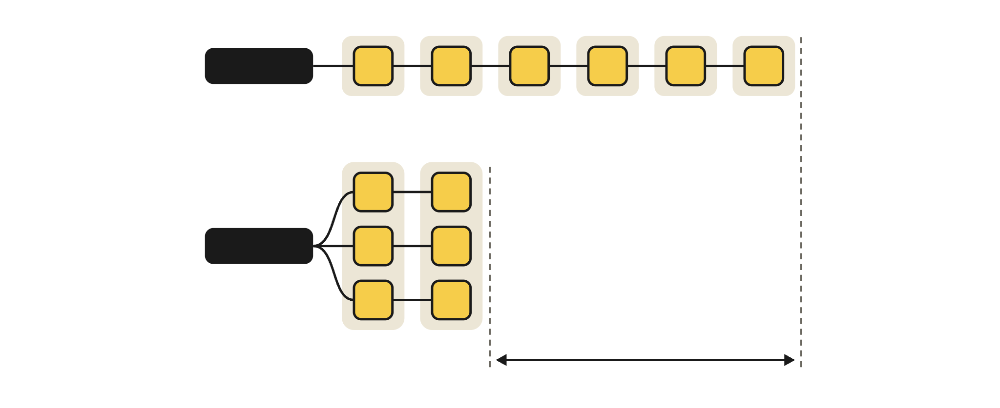
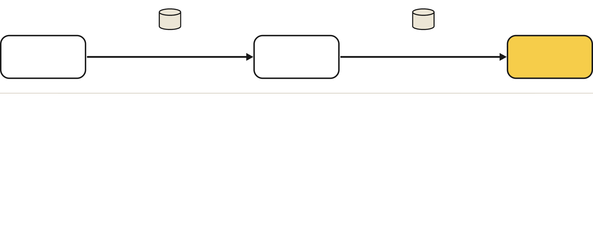

# Ошибки в данных и коде авторов

[← к сводке](README.md)

Проверка статьи [arXiv 2509.07980](https://arxiv.org/abs/2509.07980) против опубликованного кода
(upstream `f1c6389`). Подробный аудит — `experiments/qwen06/PAPER_CODE_AUDIT.md` в ветке
`qwen3-0.6b-rl`; заметки по SFT — `docs/changes.md` в `exp/10-sft-rollout-views`.

## Как устроен Parallel-R1

Модель сама пишет `<Parallel>`; рантайм запускает ветки `<Path>` с общим префиксом, каждая ветка не видит
соседей, затем модель пишет `
` и продолжает рассуждение. В варианте **Seen** обучение идёт с обычной
causal-маской; в **Unseen** — со структурной маской и повторяющимися position id (рисунок выше в [сводке](README.md)).
Ветки генерируются одним батчем, поэтому три пути длиной 2 токена после префикса стоят 2 прохода вместо 6:

Пайплайн статьи: Qwen3-4B-Base → SFT на Parallel-GSM8K (формат) → RL на GSM8K + DAPO.
Награда S2 (Unseen): +1.2 за верный ответ с блоком, +1 за верный без блока, −1 иначе
(бонус включён на шагах 9–10 каждого цикла из 10).

## Данные SFT (Parallel-GSM8K)

Реальный пример из обучающего файла авторов: ответ посчитан до блока, два пути повторяют друг друга
(«умножить 8×7» и «сложить 8 семь раз»), Summary пересказывает их же.

1. **Ответ посчитан до блока `<Parallel>`** — ветки ничего не добавляют.
2. **Пути дублируют друг друга.**
3. **Summary бесполезен.**
4. **Неверные шаги** — в части примеров ответ верный, а рассуждение нет.
5. **Одна форма:** в 94% ответов ровно 2 блока, в 99% блоков ровно 2 пути. Модель учит шаблон,
   а не решение «когда и на сколько ветвиться».
6. 38 примеров с битыми тегами (эксперимент `exp/06` их фильтрует).

## Код

| Проблема | Последствие | Что сделали |
|---|---|---|
| **Маски Unseen при генерации и обучении разные.** vLLM получает только `prompt_token_ids`: Summary и продолжение генерируются с обычной causal-маской и обычными позициями, а actor пересчитывает log-prob со структурной маской | Sampling и обучение относятся к разным политикам; метрики авторов для Unseen некорректны | 4B-рантайм записывает точный контекст каждого вызова и воспроизводит его в replay ([06](06-engineering.md)); в SFT — `exp/10` (SFT в тех же видах, что и роллаут, логиты совпадают до 3.6e-7) |
| **Токены, вставленные рантаймом** (`<Path>`, `</Parallel>`, перевод строки, `
`) входят в PPO loss: исключение закомментировано | Градиент на «действия», которые модель не выбирала | В 4B loss = 0 на вставках, 1 на всех sampled-токенах; в 0.6B — опция; `exp/07` — то же для SFT |
| **Позиции промпта.** Инструкция содержит теги как спецтокены, парсер структуры принимает их за блок: 47 из 239 токенов промпта получают позицию 0, ответ сдвигается на 46 | На обучении после `<Parallel>` модель ставит `<Path>` с вероятностью 0.989, на инференсе — перевод строки (0.78). В свободной генерации 0% правильных тегов | Структура только для ответа, промпт нумеруется подряд (`exp/02`): правильных тегов 67% → 88% |
| **Одинаковые эмбеддинги тегов в 0.6B.** Теги получают неиспользуемые строки эмбеддингов; в Qwen3-0.6B-Base они одинаковые (в 4B — различаются) | Шесть тегов неразличимы, 1.7% правильных тегов после SFT | Инициализация тега средним эмбеддингом его кусков (`<`, `Path`, `>`) |
| Верификатор ищет `Final Answer:` в последних 300 символах | `\boxed{}` без этой строки получает −1 | Math-Verify 0.8.0 на финальном ответе после `</think>` в 4B |
| Длина: путь обрезается уже после генерации, объединение путей может превысить бюджет ответа | Обрезанные блоки, нечестный учёт длины | Реальные `max_tokens` на main/path/summary, логирование |
| Val loss SFT считается на тесте GSM8K без тегов | Растёт 1.14 → 1.22 — это уход от исходного стиля, а не переобучение | — |
| Позиции веток «непересекающиеся» в статье (§3.5.1), а в коде оба пути стартуют с одной позиции | Расхождение текста и кода | Задокументировано |

Опубликованные авторами веса и наши исправления: 4B checkpoint авторов (S2, шаг 200) на нашем протоколе
находится на графике [точность против форвардов](05-rl-4b.md#rl-без-sft): ≈38% при ≈1.5k форвардов
(без AIME 2026).
