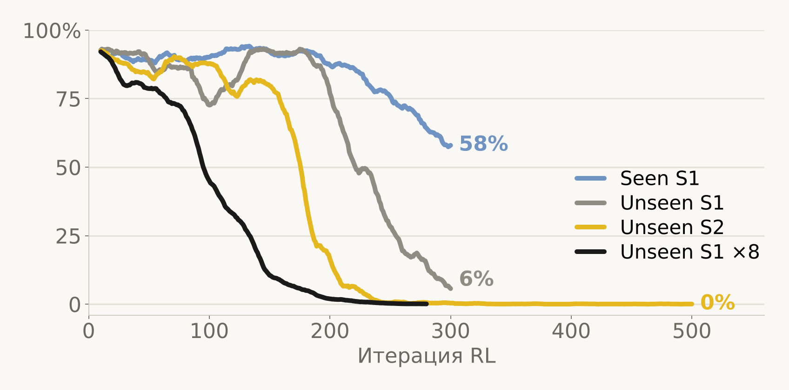
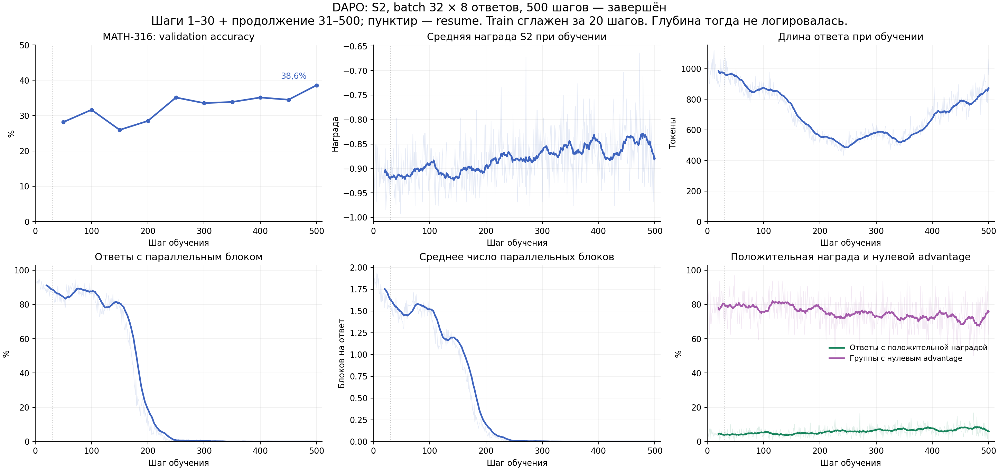
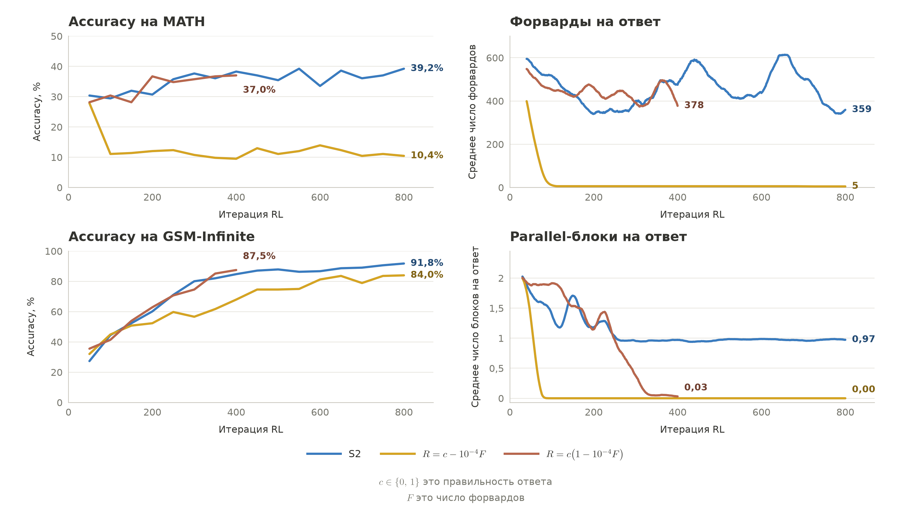
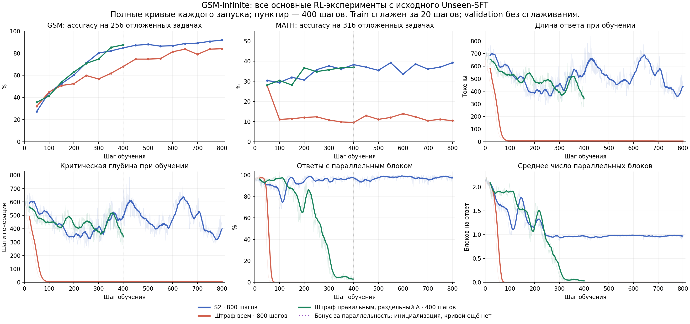
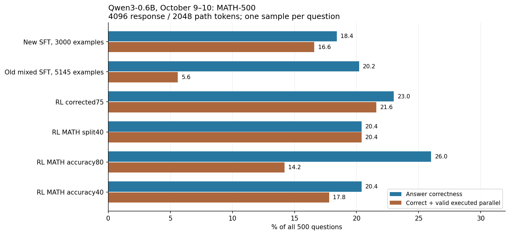

# RL Qwen3-0.6B

[← к сводке](README.md)

Все запуски стартуют из исправленного Unseen-SFT 0.6B (не из предыдущего RL), 8×A100, n=8 ответов на
вопрос, LR 1e-6, token-mean loss. Инфраструктура для одной A100 (S1/S2, трейсы, восстановление после
прерывания ВМ, Figure 3) — ветка `qwen3-0.6b-rl`, `experiments/qwen06/README.md`.
Многоузловой вариант, телеметрия и награды — эта ветка (`scripts/qwen3.sh`, `scripts/rl_efficiency.sh`).

## DAPO S1/S2: блоки исчезают

DAPO train — 17 917 вопросов; валидация авторов — 1916 ответов (AIME24/25, AMC23 ×16, MATH-316 ×1).
S1 — награда только за правильность; S2 — расписание авторов (+1.2 за верный ответ с блоком на шагах 9–10
каждого цикла).

| Запуск | Шагов | Ответов с блоком в конце | MATH-316 |
|---|---:|---:|---:|
| Seen S1 | 300 | 58% | — |
| Unseen S1, batch 32 | 300 | 6% | 116/316 = 36.7% |
| Unseen S2, batch 32 | 500 | 0% | 122/316 = 38.6% |
| Unseen S1 ×8 (batch 256) | 280, остановлен | ≈0% | 156/316 = 49.4% |

Unseen-модель при RL отказывается от блоков даже с бонусом S2 — «бонус за ветки не спас».
Seen держит блоки дольше всего. Шаги разных batch не равны по объёму работы
(batch 32 = 256 ответов/шаг, batch 256 = 2048).

## GSM-Infinite: штраф за длину

Train — 4547 вопросов `gsm_infinite_medium_0` (ops 2–6), held-out GSM256 + MATH316, validation каждые 50 шагов.
$c$ — правильность, $F$ ($D$ в коде) — критическая глубина декодирования (последовательные токены
main/summary + максимум по параллельным путям), $T$ — все сгенерированные токены, $v$ — валидный блок.

| Награда | Шагов | GSM256 | MATH316 | Блоков на ответ в конце |
|---|---:|---:|---:|---:|
| S2 авторов | 800 | 91.8% | 39.2% | 0.97 |
| $c - 10^{-4} F$ | 800 | 84.0% | **10.4%** | 0.00 |
| $c - 10^{-4} c F$, split advantage | 400 | 87.5% | 37.0% | 0.03 |
| $c + 0.2\, c\, v\, (1 - F/T)$, split advantage | 400 | 85.6% | 36.1% | — |

Безусловный штраф: за ~100 шагов ответы схлопываются до ~5 форвардов, MATH падает с 28% до 10% —
модель «впала в тильт». Штраф только для верных ответов (gated) и раздельный advantage избегают коллапса,
но блоки всё равно исчезают (0.78% ответов с блоком на GSM, 16.5% на MATH на шаге 400).

Скрининг наборов (исходный Unseen-SFT, 256 вопросов × 8 ответов): точность DAPO 4.4% / смешанных групп 24.2%,
GSM-Infinite 18.6% / 71.9%, Orca 31.8% / 58.6%, CN K12 21.0% / 48.1%. У GSM 24% ответов равны `4` —
поэтому обязательна отдельная оценка на MATH.

Формулы, лаунчер и проверки — [docs/efficiency-rl.md](../efficiency-rl.md).

## Ночная кампания 9–10 октября: разделённые advantage

RL от новых SFT 0.6B (корпус 3000), 8 промптов × 4 ответа, KL 0.001, ответ 4096 / ветка 2048.
Advantage за правильность и за эффективность считаются отдельно, без деления на std:

Стоимость длины ($F_i$ — критическая глубина, $y_i\in\{0,1\}$ — правильность):

$$C_i = \mathrm{clip}\left(\frac{\max(F_i - 256,\ 0)}{1024},\ 0,\ 1\right)$$

$$A^{\mathrm{acc}}_i = y_i - \operatorname{mean}_{\text{group}}(y), \qquad A_i = A^{\mathrm{acc}}_i + A^{\mathrm{eff}}_i$$

- accuracy: $A^{\mathrm{eff}}_i = 0$;
- split: $A^{\mathrm{eff}}_i = 0.05\, y_i \left(\operatorname{mean}_{\text{correct}}(C) - C_i\right)$, только если в группе не меньше двух верных ответов, иначе 0.

Полный MATH-500, один ответ на задачу, checkpoint выбран заранее по отдельному набору mixed128:

| Checkpoint | Accuracy | Верно + валидный исполненный блок |
|---|---:|---:|
| Новый SFT (3000), 105 шагов | 18.4% | 16.6% |
| Старый смешанный SFT (5145), 180 шагов | 20.2% | 5.6% |
| RL corrected, шаг 75 | 23.0% | 21.6% |
| RL MATH split, шаг 40 | 20.4% | 20.4% |
| RL MATH accuracy, шаг 80 | **26.0%** | 14.2% |
| RL MATH accuracy, шаг 40 | 20.4% | 17.8% |

То же, что и на 4B: награда только за правильность даёт лучшую точность, но модель отходит от формата;
split-advantage сохраняет блоки во всех верных ответах ценой точности.

## Почему убрали деление на std

GRPO нормирует награды внутри группы: $\hat A_i = (R_i - \operatorname{mean}(R)) / \operatorname{std}(R)$. Когда все ответы верные и отличаются только
слабым штрафом за форварды, std крошечный, и микроскопическая разница превращается в полноценный сигнал:

| Форварды $F$ | 905 | 908 | 910 |
|---|---:|---:|---:|
| Награда $R$ | 0.9095 | 0.9092 | 0.9090 |
| Advantage $\hat A$ | +1.30 | −0.16 | −1.14 |

Разница в 5 форвардов из 900 весит как разница «верно/неверно». Отсюда два решения:
в 0.6B — опциональный `algorithm.split_accuracy_aux=true` (правильность и вспомогательная награда нормируются
отдельно, коэффициент сохраняется); в 4B — только вычитание среднего по 4 ответам одного промпта, без деления на std.
К тому же выводу пришли в ThreadWeaver (Meta, 2025, [arXiv:2512.07843](https://arxiv.org/abs/2512.07843)).

## Ограничения

Legacy vLLM-генерация и пересчёт в actor используют разную семантику маски/позиций, вставленные токены могли
входить в loss ([01](01-authors-issues.md)). Один seed, 256/316 задач валидации, разные бюджеты обучения —
статистического превосходства эти таблицы не показывают.
