# RL Qwen3-4B

[← к сводке](README.md)

Код:

- HF-рантайм R2 (FP32, на нём обучен RL50) в переиспользуемом виде —
  [experiments/parallel_instruct](../../experiments/parallel_instruct/README.md);
- vLLM-движок, на котором обучены RL300 и R4, — только замороженный снимок в
  [docs/reproduction/4b-2026-10-14](../reproduction/4b-2026-10-14/README.md) (там же данные, хеши и команды запуска);
- оценка на бенчмарках — [docs/reproduction/benchmark-eval-2026-10-13](../reproduction/benchmark-eval-2026-10-13/README.md);
- все точки графиков и формулы агрегации — [benchmark-trajectories](../reproduction/benchmark-trajectories-2026-10-14/README.md).

Общее для всех запусков: 4 ответа на промпт, synchronous rollout, один PPO epoch, clip 0.2, AdamW lr 1e-6,
без KL и entropy bonus. Advantage = награда − среднее по 4 ответам, **без деления на std**
([почему](03-rl-0.6b.md#почему-убрали-деление-на-std)). Все ветки форка (ширина до 8) исполняются в одном forward;
$F$ — физические вызовы `model.forward` при генерации. Loss 0 на вставленных рантаймом заголовках, 1 на всех
sampled-токенах. Оценка: MATH500 (500) + AIME 2024/2025/2026 (по 30), один ответ на задачу, 32k токенов,
Math-Verify по ответу после `</think>`.

## Выбор награды: R1 против R2

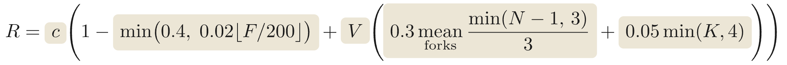

$$P(F) = \min\left(0.4,\ 0.02 \left\lfloor \frac{F}{200} \right\rfloor\right), \qquad U = \operatorname{mean}_{\text{forks}} \frac{\min(N - 1,\ 3)}{3}$$

$$R_1 = c\,\bigl(1 - P(F)\bigr), \qquad R_2 = c\,\Bigl(1 - P(F) + V\,\bigl(0.3\,U + 0.05 \min(K,\ 4)\bigr)\Bigr)$$

$c$ — правильность, $V$ — валидный формат, $N$ — число веток в форке, $K$ — число последовательных форков,
$P(F)$ — штраф за форварды, $U$ — бонус за ширину. Неверный ответ — 0.

Сначала оба варианта прогнали от Full SFT на маленьком наборе (128 задач, 8 GPU, 32 ответа/шаг, FP32,
ответ 4096 / ветка 768). MATH-500 на 64-м шаге:

| Checkpoint | Accuracy | Валидный формат | Верно + исполненный форк | Форвардов на ответ |
|---|---:|---:|---:|---:|
| Full SFT | 50.2% | 91.4% | 46.2% | 747 |
| R1, шаг 64 | **70.6%** | 55.4% | 43.4% | 899 |
| R2, шаг 64 | 56.0% | 91.2% | **52.4%** | 683 |
| R2, шаг 50 на 1024 задачах | 78.4% | 88.6% | 76.4% | 1 209 |

Только штраф за форварды (R1) быстрее всего поднимает точность, но модель бросает формат: валидных ответов
55%. R2 удерживает формат, поэтому дальше пошли с ним и расширили данные до 1024 задач
(512 CN K12 + 512 Orca из Big-Math, ответы проверены teacher'ом без доступа к эталону).

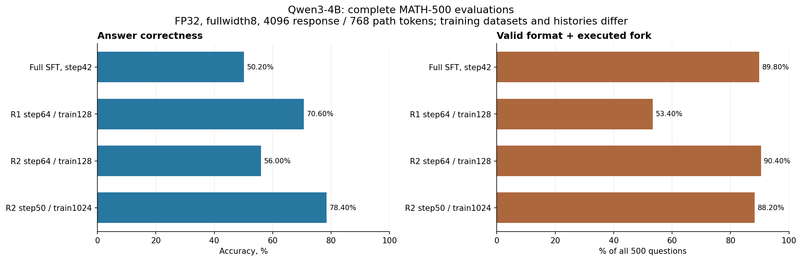

## RL50 против оригинального Instruct на сложных задачах

R2 RL50 (24 GPU, 96 ответов/шаг, FP32) на AIME/AMC при 32k токенов против исходного `Qwen/Qwen3-4B`
с native thinking:

| | RL50 | Qwen3-4B Instruct |
|---|---:|---:|
| AIME 2024 | 33.3% | 73.3% |
| AIME 2025 | 13.3% | 63.3% |
| AIME 2026 | 13.3% | 73.3% |
| AMC 2023 | 62.5% | 92.5% |

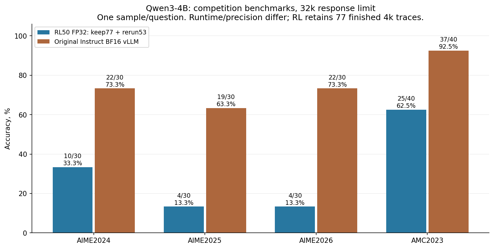

Разрыв огромный: parallel-формат после нашего SFT стоит модели большей части умения решать сложные задачи.
Дальше задача RL — вернуть эту точность, не потеряв ветвление.

## R2 RL300

RL300 продолжает веса RL50 на 32 GPU (64 ответа/шаг, новый Adam). Рантайм сменился на vLLM:
BF16 actor для генерации, FP32 master-веса и Adam у learner, token-level importance sampling
$\exp(\log p_{\text{old}} - \log q)$ с обрезкой в $[0, 2]$ ([ускорение](06-engineering.md#ускорение-rl-4b)).

| Шаг | 0 (SFT) | 50 | 100 | 150 | 200 | 250 | 300 |
|---|---:|---:|---:|---:|---:|---:|---:|
| Accuracy, % | 14.6 | 20.3 | 26.4 | 34.6 | 37.7 | 36.6 | **48.4** |
| Форвардов на ответ | 1 009 | 1 399 | 1 904 | 3 166 | 3 845 | 4 126 | 3 919 |
| Ширина форка | 3.07 | 3.49 | 4.01 | 4.08 | 4.10 | 4.19 | 4.44 |
| Форков на ответ | 1.03 | 1.07 | 1.01 | 1.02 | 1.00 | 0.98 | 0.86 |

RL300 по наборам: MATH500 87.0%, AIME24 43.3%, AIME25 36.7%, AIME26 26.7%.

Что пошло не так:

1. **Почти всегда 4 ветки.** Бонус за ширину растёт только до 4 веток (+0.10 / +0.20 / +0.30 для 2 / 3 / 4–8),
   и модель упирается в потолок: 83% форков ровно 4-ветвевые.
2. **Summary длиннее веток.** Ветки — 52% токенов ответа, Summary — 27%, план — 14%: модель переделывает
   работу в сводке.
3. **Форков меньше:** 1.03 → 0.86 на ответ; модель чаще отвечает без блока.
4. **Блок в начале ответа.** В статье `<Parallel>` смещается к концу (40% → 70% позиции, «exploration →
   verification»); у нас стоит около 20% и не растёт.

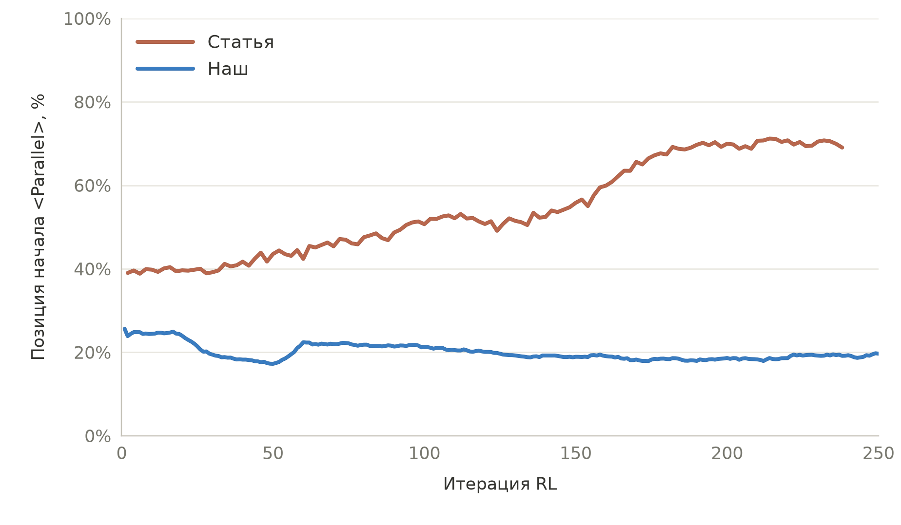

Диагностика на val32 (32 фиксированные задачи, не бенчмарк) по ходу обучения:

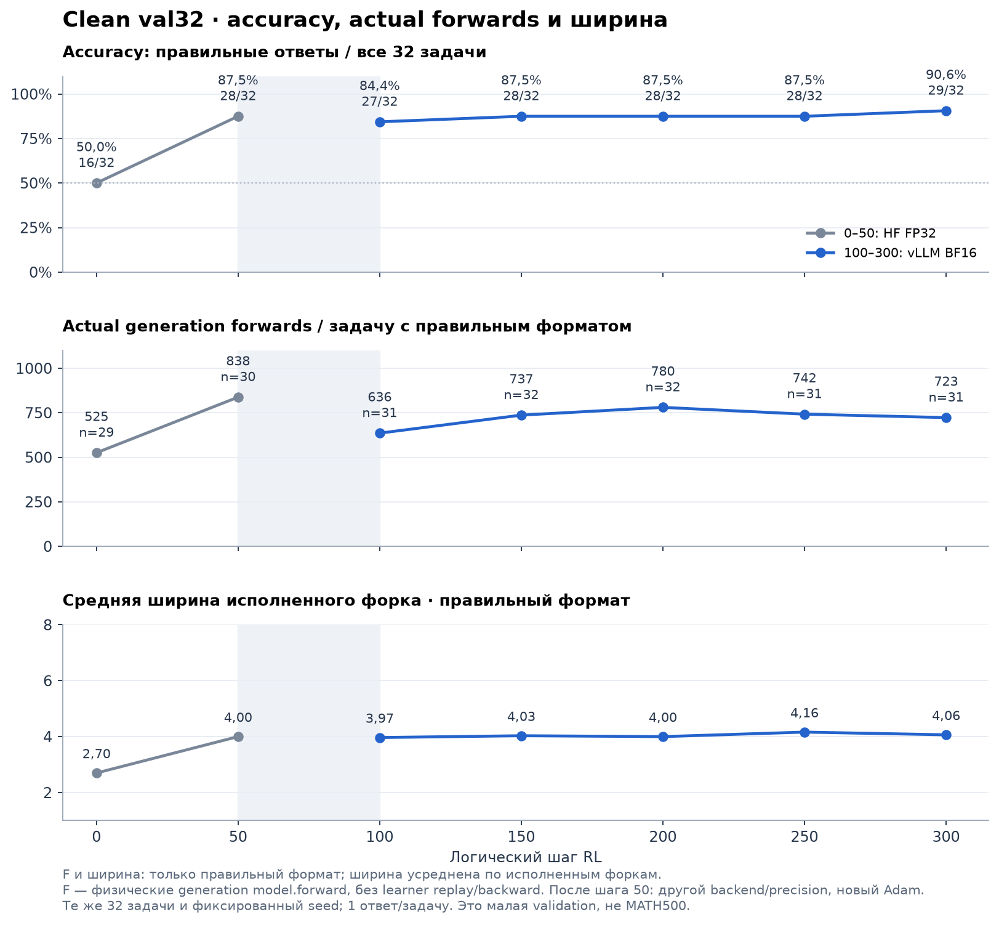

val32 насыщается к шагу 50 (≈88%) и дальше не различает checkpoint'ы, тогда как на бенчмарках точность растёт
с 20% до 48%. Для отбора checkpoint'ов нужен более сложный dev-набор.

## R4: новая награда за форварды

R4 RL150 стартует **от SFT** (не продолжает RL300): DAPO 2000 задач, 16 GPU, 64 ответа/шаг,
ответ до 32000 токенов, путь до 4000. Бонусов за формат, ширину и раунды нет.

$$R = c\,\Bigl(1 - 0.9\,\bigl(1 - e^{-\ln 9 \cdot F / 10000}\bigr)\Bigr)$$

При $F = 10\,000$ верный ответ получает 0.2, предел при $F \to \infty$ — 0.1. Штраф гладкий и сильнее старого ступенчатого:

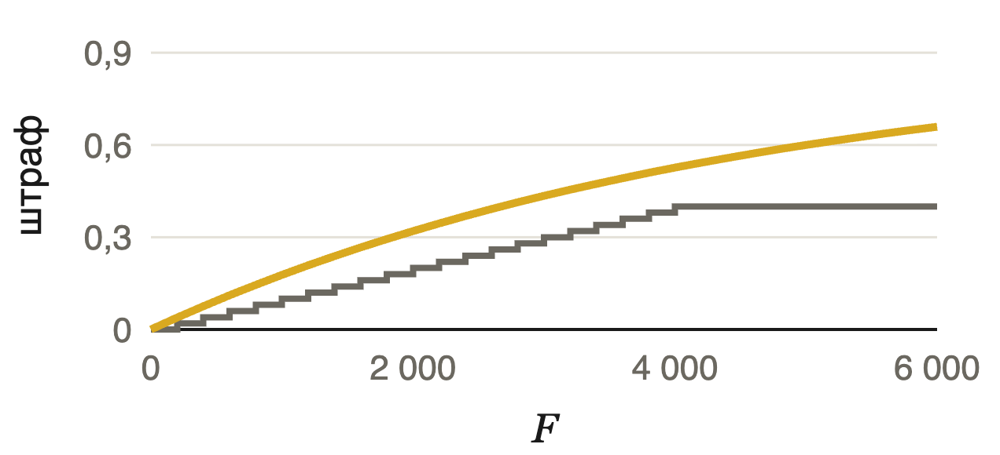

| | Accuracy | Форвардов | Ширина | Форков |
|---|---:|---:|---:|---:|
| R2 RL150 | 34.6% | 3 166 | 4.08 | 1.02 |
| R4 RL150 | 29.6% | 2 273 | 2.85 | 0.79 |

Распределение ширины форков на MATH500 — R2 RL300 (было) против R4 RL150 (стало):

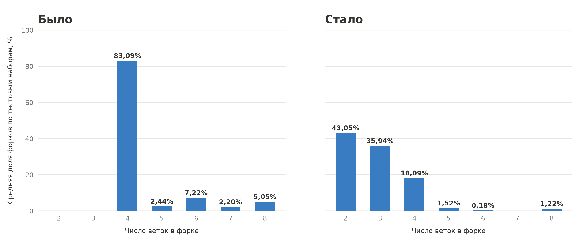

Доля токенов ответа по частям на MATH500:

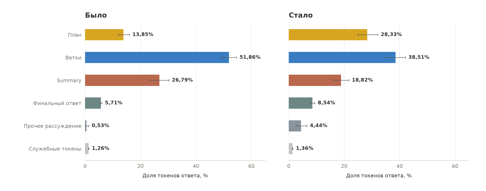

Новая награда убирает упор в 4 ветки (43% форков 2-ветвевые, 36% — 3-ветвевые) и сокращает ветки и Summary
в пользу плана. Точность при этом ниже, чем у R2 на том же шаге, и форков на ответ меньше.
Сравнение по наборам с прежними данными R2 (протоколы и данные различаются):

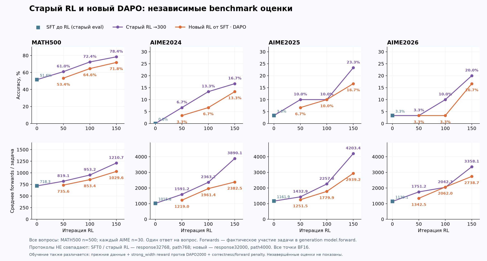

Train-кривые R4 (sampled train-батчи, не бенчмарки). Слева — R4 от SFT, шаги 1–150 (фиолетовая линия —
старый RL на другом корпусе, для ориентира); справа — продолжение RL300 с наградой R4, шаги 301–318:

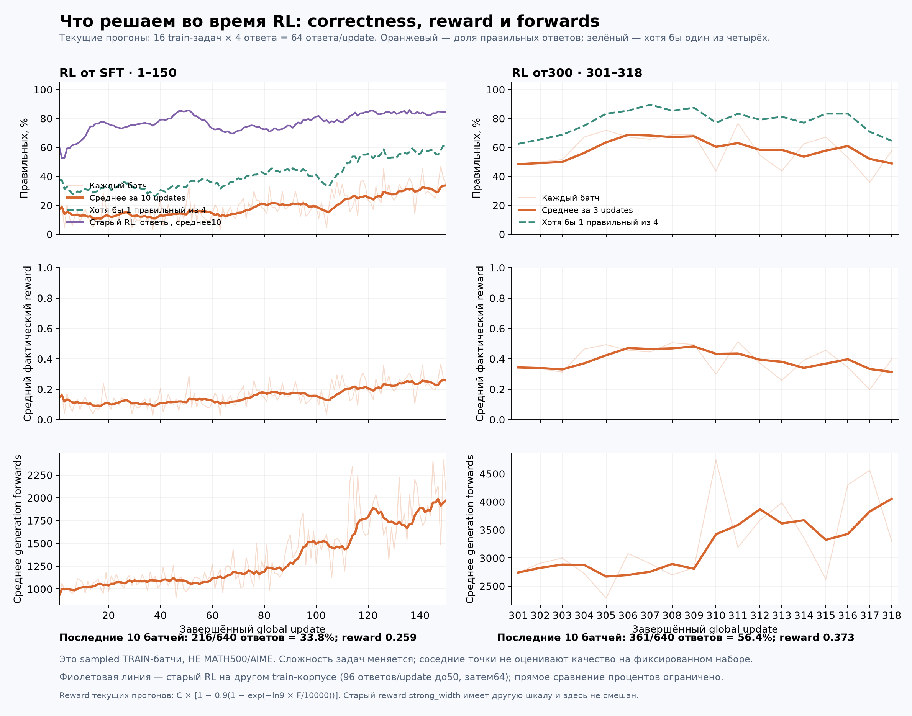

## Две случайные ветки из объявленных

Тот же checkpoint RL300. Модель, как обычно, объявляет `<Parallel>N` и план на N веток, но исполняются только
2 случайные из N (выбор детерминирован seed'ом задачи; бюджет на ветку считается как для N, номера `<Path>k`
сохраняются). Если веток работает меньше, чем модель задумала, что теряется?

| | MATH500 | AIME24 | AIME25 | AIME26 |
|---|---:|---:|---:|---:|
| Все объявленные ветки | 87.0% | 43.3% | 36.7% | 26.7% |
| 2 случайные из N | 84.8% | 26.7% | 26.7% | 16.7% |
| Форвардов на ответ, все → 2 | 1 319 → 1 286 | 6 658 → 4 466 | 4 392 → 3 580 | 3 307 → 3 368 |

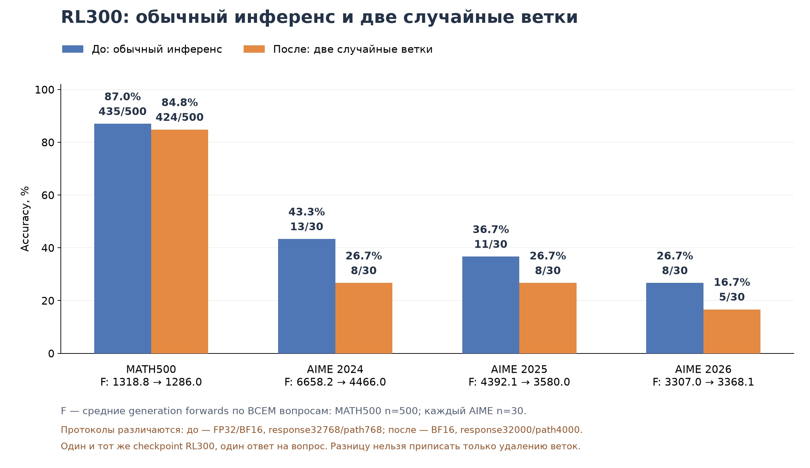

На простых задачах (MATH500) почти ничего не меняется, на AIME теряется 10–17 пунктов: ветки, которые
модель запланировала, действительно несут работу, а не только раздувают ответ. Протоколы немного различаются
(BF16, 32000/4000 против 32768/768), поэтому всю разницу нельзя приписать только веткам; на AIME это 30 задач
на набор, то есть 3–5 задач разницы.

## Продолжения от RL300

После шага 300 запущены продолжения с более сильным штрафом за длину:

- **R3**: штраф за форварды ×5 ($\min(0.8,\ 0.10 \lfloor F/200 \rfloor)$), бонус за ширину вдвое меньше (0.15),
  ответ 32768 / ветка 4096, цель — шаг 400;
- **RL300 + награда R4**: та же экспоненциальная награда, что у R4 ниже, 64 ответа/шаг.

Сохранились только train-кривые продолжения с наградой R4 (шаги 301–318, правая колонка графика
[ниже](#r4-новая-награда-за-форварды)): доля верных ответов в батче ≈50–60%, форварды растут с ≈2.7k до ≈4k.
Оценок этих продолжений на бенчмарках нет.

## RL без SFT

От оригинального Qwen3-4B (без нашего SFT, без parallel-формата), лимит 16k токенов, один ответ на задачу,
награда только за правильность и форварды:

$$R = c\,\Bigl(1 - \min\bigl(0.4,\ 0.02 \lfloor F/200 \rfloor\bigr)\Bigr)$$

| Шаг | 0 | 150 |
|---|---:|---:|
| MATH-500, точность | 94.0% | 92.6% |
| AIME 2024 | 70.0% | 53.3% |
| AIME 2025 | 53.3% | 46.7% |
| Форвардов: MATH-500 | 4 206 | 933 |
| Форвардов: AIME 2024 | 10 806 | 5 753 |
| Форвардов: AIME 2025 | 11 919 | 6 865 |

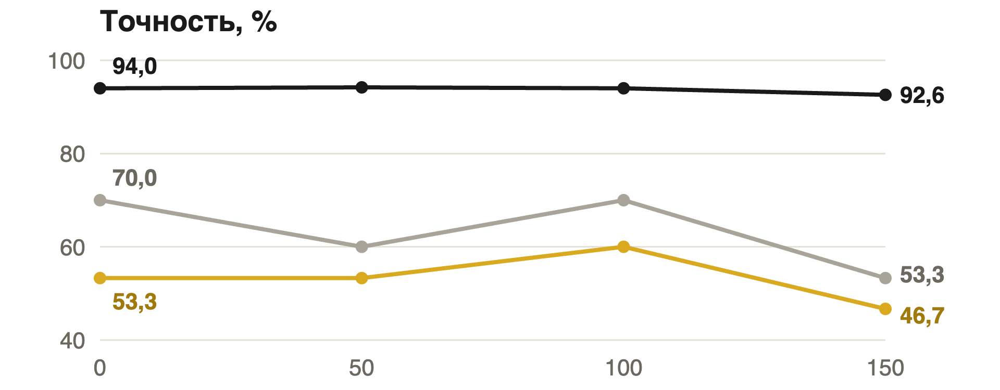

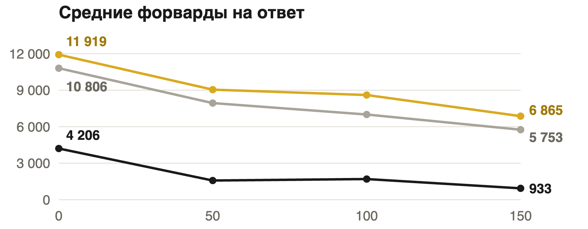

«Плот-твист: хватило просто не болтать» — в 4 раза меньше форвардов на простых задачах и в 2 раза на сложных,
точность на MATH почти не падает, на AIME падает заметно.

На плоскости «точность × форварды» RL без SFT лежит между Instruct и SFT+RL; checkpoint авторов (S2, шаг 200,
без AIME 2026) — около 38% при ~1.5k форвардов.

> **Источник данных этого раздела не найден в репозитории.** Числа и графики взяты со слайдов 12–13 презентации;
> исходные результаты и код этого запуска нужно добавить (сопоставление серий графика с наборами — по порядку подписей
> на слайде).

## Что дальше

Parallel-блоки против субагентов:

| | Parallel-блоки | Субагенты |
|---|---|---|
| Длина контекста | − все пути копятся в контексте | + обмен только задачей и результатом |
| Контекст пути | + общий: путь видит задачу и план | − задачу объяснять каждому заново |
| Скорость | + пути идут параллельно | + субагенты работают параллельно |
| Связь | − пути не видят друг друга | − субагенты не видят друг друга |

Идея «что было в Parallel — остаётся в Parallel»: после Summary продолжение видит префикс и сводку,
но не план и сами ветки — контекст не растёт с каждым форком.

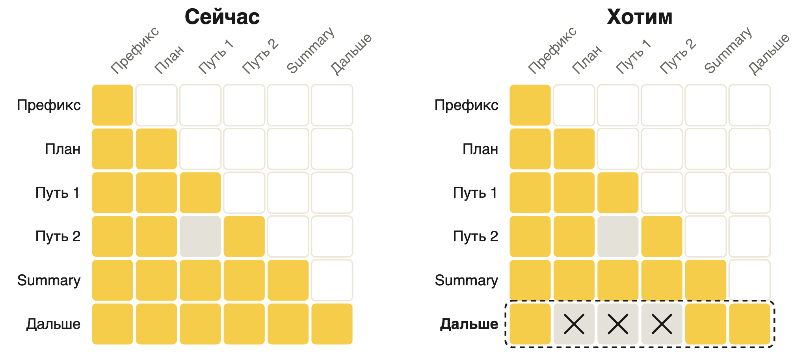
