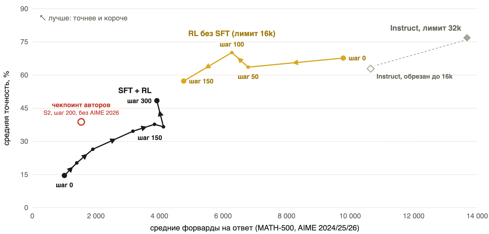

# Parallel-R1: что мы сделали

Воспроизведение и развитие [Parallel-R1](https://arxiv.org/abs/2509.07980) («параллельное мышление»:
модель сама открывает `<Parallel>`, ветки `<Path>` генерируются независимо, `
` их сводит)
на Qwen3-0.6B и Qwen3-4B, октябрь 2026. Здесь собраны эксперименты из всех веток проекта, включая те,
что не вошли в презентацию «Parallel-R1 с видео».

## Как читать

1. Эта страница — история проекта, главные числа и что где лежит.
2. [01 — ошибки в данных и коде авторов](01-authors-issues.md): без этого непонятны остальные решения.
3. По порядку работы: [02 — SFT 0.6B](02-sft-0.6b.md) → [03 — RL 0.6B](03-rl-0.6b.md) →
   [04 — SFT 4B](04-sft-4b.md) → [05 — RL 4B](05-rl-4b.md).
4. [06 — код](06-engineering.md): что исправлено, где лежит код каждого этапа, ускорение RL. Для тех, кто будет запускать.

## История коротко

1. **Код авторов воспроизводит не то, что описано в статье.** В Unseen маски при генерации (vLLM) и при
   обучении разные; в loss попадают токены, которые вставляет рантайм; теги из инструкции ломают позиции
   промпта; у 0.6B все шесть тегов получают одинаковый эмбеддинг. SFT-данные авторов почти всегда одной формы
   (2 блока × 2 пути), ветки дублируют друг друга. → [01](01-authors-issues.md)
2. **SFT 0.6B по рецепту авторов учит формату, а не решению задач.** Различимые эмбеддинги тегов
   (1.7% → 67% правильных тегов) и исправленные позиции промпта (67% → 88%) сильно улучшают структуру;
   по точности все варианты в пределах шума, ≈10% против 31.7% у авторов на 4B. Нативный post-trained
   Qwen3-0.6B решает MATH-500 на 51–74%. → [02](02-sft-0.6b.md)
3. **RL 0.6B: модель перестаёт ветвиться.** На DAPO доля ответов с блоками падает до 0–6% в Unseen S1/S2
   (58% в Seen). Безусловный штраф за длину ломает модель (MATH 39% → 10%). Во всех вариантах награда только за
   правильность даёт лучшую точность и худший формат. Деление на std в GRPO раздувает микроскопические
   различия наград — убрали. → [03](03-rl-0.6b.md)
4. **4B: старт от Instruct и свой SFT-корпус.** 3000 решений GSM-Infinite от DeepSeek: план до блока, явная
   ширина `<Parallel>N`, у каждой ветки своя подзадача. Обучения одних тегов мало: модель рассуждает как раньше
   и оформляет теги после `</think>`. Полный SFT даёт формат, но средняя точность падает 76.9% → 14.6%. → [04](04-sft-4b.md)
5. **RL 4B.** Только штраф за длину (R1) быстрее поднимает точность, но формат держится у 55% ответов;
   с бонусом за ширину и раунды (R2) формат сохраняется. R2 RL300: 14.6% → 48.4% (MATH500 87%, AIME 27–43%),
   но 83% форков ровно 4-ветвевые, Summary длиннее веток, `<Parallel>` не смещается к концу, как в статье.
   Новая награда R4 возвращает форки шириной 2–3, точность ниже. Если исполнять только 2 случайные из N
   объявленных веток, AIME падает на 10–17 пунктов — ветки несут работу. RL от Qwen3-4B без SFT сокращает
   форварды в 2–4 раза при небольшой потере на MATH и заметной на AIME. → [05](05-rl-4b.md)
6. **Инженерия.** Учёт реальных вызовов `model.forward`, точный replay структурированных контекстов,
   запуск на 1–32 GPU с той же эффективной батчем, ускорение RL 4B в 1.62× без изменения результатов,
   затем vLLM-движок со структурными масками. → [06](06-engineering.md)

## Главные числа

Qwen3-4B, MATH500 + AIME 2024/2025/2026, один ответ на задачу, 32k токенов, macro-среднее по четырём наборам
([расчёт](../reproduction/benchmark-trajectories-2026-10-14/README.md), [код оценки](../reproduction/benchmark-eval-2026-10-13/README.md)).

| Модель | Accuracy | Форвардов на ответ | Ширина форка | Форков на ответ |
|---|---:|---:|---:|---:|
| Qwen3-4B Instruct | 76.9% | 13 677 | — | 0 |
| Наш SFT (шаг 0) | 14.6% | 1 009 | 3.07 | 1.03 |
| R2 RL150 | 34.6% | 3 166 | 4.08 | 1.02 |
| **R2 RL300** | **48.4%** | 3 919 | 4.44 | 0.86 |
| R4 RL150, новая награда | 29.6% | 2 273 | 2.85 | 0.79 |

Instruct точнее всех parallel-моделей, наши модели в 3–14 раз короче. RL без SFT (жёлтая линия) — между
ними: 57–70% при 5–10 тыс. форвардов.

## Чего не было в презентации

- Таблицы SFT-абляций 0.6B и шум оценки → [02](02-sft-0.6b.md#абляции-sft-по-рецепту-авторов-exp)
- Ночная кампания 0.6B с разделёнными advantage → [03](03-rl-0.6b.md#ночная-кампания-910-октября-разделённые-advantage)
- Почему одного прогрева токенов мало, Deep SFT → [04](04-sft-4b.md#почему-одного-прогрева-токенов-мало)
- Выбор награды R1 против R2 → [05](05-rl-4b.md#выбор-награды-r1-против-r2)
- RL50 против Instruct на AIME/AMC → [05](05-rl-4b.md#rl50-против-оригинального-instruct-на-сложных-задачах)
- Позиция `<Parallel>` против Figure 3 статьи, насыщение val32 → [05](05-rl-4b.md#r2-rl300)
- Продолжения от RL300 (R3, R4) → [05](05-rl-4b.md#продолжения-от-rl300)
- Ускорение RL 4B → [06](06-engineering.md#ускорение-rl-4b)

## Слайды презентации

| Слайд | О чём | Где подробно |
|---|---|---|
| 2–3 | Формат, маска внимания, экономия форвардов при parallel batch | [01](01-authors-issues.md#как-устроен-parallel-r1) |
| 4 | Пайплайн авторов; на 0.6B блоки исчезают при RL на DAPO | [03](03-rl-0.6b.md#dapo-s1s2-блоки-исчезают) |
| 5 | Ошибки в данных и коде авторов | [01](01-authors-issues.md) |
| 6 | Штраф за длину → модель «впала в тильт» | [03](03-rl-0.6b.md#gsm-infinite-штраф-за-длину) |
| 7 | Advantage в GRPO и деление на std | [03](03-rl-0.6b.md#почему-убрали-деление-на-std) |
| 8 | Наш SFT-корпус | [04](04-sft-4b.md) |
| 9 | RL на 4B, награда R2 | [05](05-rl-4b.md#r2-rl300) |
| 10 | Ширина форков и состав токенов: было/стало | [05](05-rl-4b.md#r4-новая-награда-за-форварды) |
| 11 | Две случайные ветки | [05](05-rl-4b.md#две-случайные-ветки-из-объявленных) |
| 12–13 | RL без SFT, точность против форвардов | [05](05-rl-4b.md#rl-без-sft) |
| 14–15 | Parallel против субагентов; маска «что было в Parallel — остаётся в Parallel» | [05](05-rl-4b.md#что-дальше) |

## Где что лежит

| Место | Что там |
|---|---|
| `verl/`, `scripts/`, `tests/` | Qwen3 SFT/eval/RL для 0.6B на verl, награды эффективности |
| `experiments/parallel_instruct/` | HF-рантайм RL 4B (R2) на 1–32 GPU |
| `docs/reproduction/4b-2026-10-14/` | Снимок SFT 4B, RL50/RL300/R4: данные, конфиги, vLLM-движок, команды |
| `docs/reproduction/benchmark-eval-2026-10-13/` | Код оценки 4B на MATH500/AIME при 32k и random2 |
| `docs/reproduction/benchmark-trajectories-2026-10-14/` | Данные и `plot.py` главных графиков 4B |
| `docs/report/figures`, `docs/report/sources` | Графики отчёта и их исходники |
| ветки `exp/01…10` | Абляции SFT 0.6B, `results/SUMMARY.md`, инструменты оценки тегов |
| ветка `qwen3-0.6b-rl` | RL 0.6B на одной A100, трейсы, Figure 3, аудит статьи против кода |
| ветка `sft-eval-adaptation` | Полный архив запусков 5–12 октября (84 каталога, конфигурации, метрики) |

Все измерения — один прогон, один seed, на AIME по 30 задач: разница в несколько пунктов там — 1–2 задачи
и статистически не значима.
