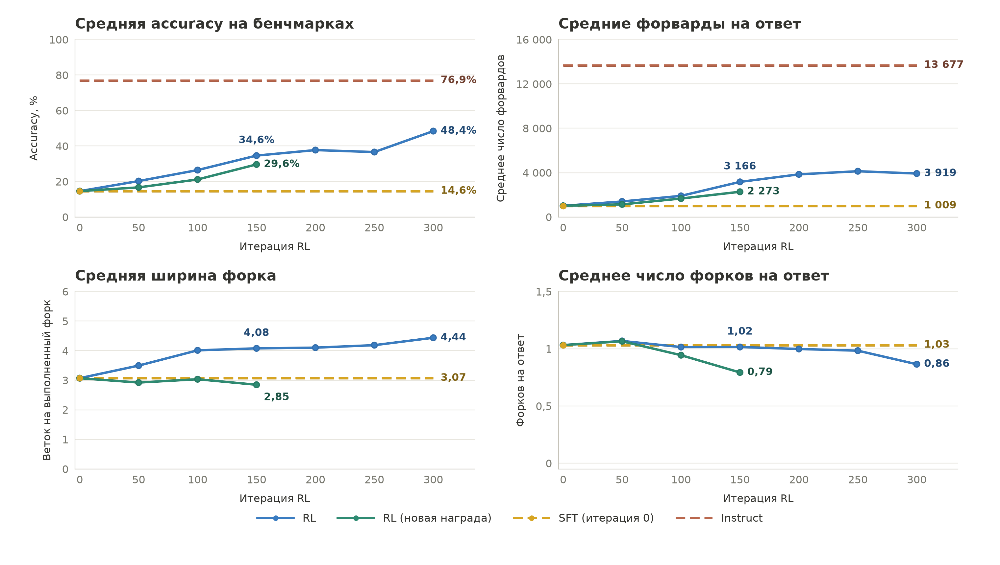

# RL300 и RL150: происхождение и воспроизведение графиков



Две версии одной оценки: [с новым RL](comparison.pdf) и [без него](comparison-original.pdf).
Доступны также PNG и SVG. Синяя линия — checkpoint'ы исходного RL на шагах
0/50/100/150/200/250/300; зелёная — новый RL от SFT до 150 на шагах
0/50/100/150. Шаг 0 — SFT; горизонтальные линии — фиксированные SFT и Instruct.
Линии соединяют измеренные точки, сглаживания нет. Подписи синей линии стоят
на шагах 150 и 300, зелёной — на 150.

## Откуда числа

Это сохранённые результаты независимого inference/evaluation, не train-batch
и не значения, снятые с изображения. На каждый checkpoint приходится
MATH500 (500 задач) и AIME2024/2025/2026 (по 30), один ответ на задачу.
Всего 590 ответов; во входном snapshot нет пропусков или technical unknown.

В этой папке достаточно данных для пересчёта всех точек без сервера и весов:

| Файл | Содержимое |
|---|---|
| `forwards-accuracy-snapshot.json` | Архив от 13.10.2026: ID задачи, correctness, F, tokens и precision для Instruct/SFT/исходного RL |
| `fork-snapshot.json` | Записи SFT/исходного RL с количеством форков, списком их ширин, SHA модели; пути и SHA-256 исходных JSONL |
| `new-reward-snapshot.json` | Аналогичные записи нового RL50/100/150, SHA моделей, reward и параметры оценки |
| `points.csv` | Все точки графиков с полной числовой точностью |
| `manifest.json` | Метрики отдельно по бенчмаркам и macro, веса, coverage, precision, определения и ограничения |
| `plot.py` | Проверки согласованности записей, агрегация и отрисовка обеих версий |
| `extract_forks.py`, `extract_new_reward.py` | Код первоначального извлечения компактных записей из серверных JSONL |
| `SHA256SUMS` | Контрольные суммы опубликованных файлов |

Исходная рабочая папка: `work/experiments/rl300-benchmark-summary-20261014/`.
Первый snapshot скопирован из
`work/experiments/eval-comparison-20261013/forwards-accuracy-snapshot.json`.
Публикуемые snapshots содержат достаточную статистику для графиков,
но не полные тексты ответов. Correctness берётся из сохранённого `grade.correct`;
`plot.py` не запускает математический grader заново. Для исходного snapshot
Instruct нет отдельного списка SHA исходных rank-файлов; его контрольная сумма
фиксирует именно сохранённые входные данные, а не независимую проверку grader.

## Как считаются метрики

Пусть $b$ — один из четырёх бенчмарков, $N_b$ — число его задач,
$C_{bi}\in\{0,1\}$ — правильность ответа, $F_{bi}$ — число форвардов,
$K_{bi}$ — число выполненных форков, $W_{bij}$ — ширина $j$-го форка.

$$\mathrm{Accuracy}=\frac{100}{4}\sum_b\frac{1}{N_b}\sum_i C_{bi}.$$

$$\overline F=\frac14\sum_b\frac{1}{N_b}\sum_i F_{bi},\qquad
\overline K=\frac14\sum_b\frac{1}{N_b}\sum_i K_{bi}.$$

$$\overline W=\frac14\sum_b
\frac{\sum_i\sum_{j=1}^{K_{bi}}W_{bij}}{\sum_i K_{bi}}.$$

Каждый бенчмарк весит 25%: это **не** объединённое среднее по 590 задачам.
Accuracy, F и число форков учитывают все ответы, включая неверные,
обрезанные и ответы с невалидным форматом. Ответ без форков даёт K=0.
Ширина — среднее по выполненным форкам, а не среднее по ответам;
ответы без форков в знаменатель ширины не входят. Затем четыре средние
ширины усредняются с равными весами. У native Instruct ширина не определена;
число форков равно нулю и по оформлению не показано на четвёртой панели.

**F в этих четырёх графиках** — сохранённый инструментированный счётчик
участия конкретного запроса в вызовах `model.forward` при генерации,
включая prefill (`instrumented_forward_calls`). Это не число всех токенов,
не общее число вызовов batched backend и не пересчитанная по длинам путей
оценка критического пути. Экстракторы сверяют его с
`stats.actual_model_forward_calls`. Ранее обсуждавшаяся формула «максимум
длин веток плюс последовательные токены» — другая метрика; здесь она
не подменяет фактический счётчик.

## Конфигурации и границы сравнения

* Исходные SFT/RL: response budget 32768, path budget 768, context 40960,
  temperature=1, top_p=1, один ответ на задачу.
* RL300: 74 ответа FP32 + 516 BF16; остальные показанные checkpoints BF16.
* Instruct использует native thinking, SFT/RL — structured parallel runtime.
* Новый RL обучен от SFT на DAPO2000 с reward
  $R=C[1-0.9(1-\exp(-\ln(9)F/10000))]$, режим `forward_only`.
  Его оценка: response 32000, path 4000, context 40960, BF16.
* Точка 0 новой линии использует существующую оценку тех же SFT-весов
  со старым бюджетом 32768/768. Смена данных обучения и бюджетов означает,
  что это **не изолированный эксперимент только по замене reward**.
* Один ответ на задачу и одна траектория обучения; интервалы неопределённости
  на рисунках не показаны.

Серверный корень при извлечении — `${PROJECT_ROOT}`.
Относительные пути исходных оценок зафиксированы в `sources` snapshots:
SFT — `eval-baselines-32k-20261013/full-sft`, исходный RL50–250 —
`eval-intermediates-vllm-rolling-32k-20261013/checkpoint-XXXX`,
RL300 — `eval-rl300-vllm-rolling-32k-20261013`, новый RL —
`rl-r4-posteval-20261013/sft/checkpoint-XXXX` (все под `work/experiments/`).
Рецепты обучения и оценки находятся в [соседней публикации](../4b-2026-10-14/README.md).

## Пересчитать и нарисовать

Проверено на Python 3.12.14. Из корня репозитория:

```bash
python3 -m venv /tmp/benchmark-plot-venv
/tmp/benchmark-plot-venv/bin/pip install -r docs/reproduction/benchmark-trajectories-2026-10-14/requirements.txt
cd docs/reproduction/benchmark-trajectories-2026-10-14
shasum -a 256 -c SHA256SUMS
MPLCONFIGDIR=/tmp/benchmark-mpl /tmp/benchmark-plot-venv/bin/python plot.py
```

Команда пересоздаёт шесть изображений, `points.csv` и `manifest.json`.
Сервер, CUDA, модель и сеть для самого пересчёта не нужны. `plot.py`
проверяет coverage, уникальность и совпадение ID, а также совпадение
correctness/F/tokens/precision между двумя исходными snapshots.
PDF/SVG могут отличаться побайтно из-за метаданных времени; числовые
результаты должны совпадать. Проверяйте `SHA256SUMS` **до** перерисовки.

Экстракторы предназначены для запуска на исходном сервере; вывод JSON
пишется в stdout. Для перерисовки опубликованных чисел повторно извлекать
данные не требуется: новые серверные файлы могут уже отличаться от архива.
